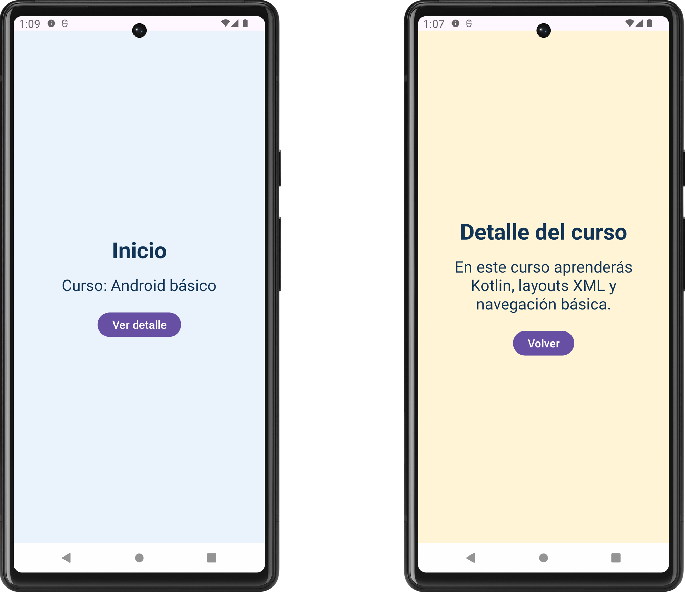

# Laboratorio adicional — Dos pantallas, una Activity

<br/><br/>

## Objetivo

Construir una aplicación PoC con Kotlin y layouts XML para navegar entre **Inicio** y **Detalle**, regresar con un botón y comprobar la acción **Atrás** del sistema.

**Duración:** 25–30 minutos con el código disponible. .


<br/><br/>

## 1. Conceptos

1. **Activity:** es el contenedor principal de esta aplicación.
2. **Fragment:** representa una pantalla o parte de la interfaz dentro de una Activity. Aquí utilizaremos uno para Inicio y otro para Detalle.
3. **NavGraph:** es el mapa de navegación. Nuestro archivo XML declara las dos pantallas, el destino inicial y la acción para avanzar.
4. **NavHostFragment:** aloja y muestra el destino actual. Lo colocaremos en el layout de la Activity mediante un `FragmentContainerView`, que es una vista contenedora de Fragments.
5. **NavController:** ejecuta la navegación y administra la pila de destinos visitados, llamada *back stack*.

<br/>

En este laboratorio, **destino** significa una pantalla del grafo y **acción** significa una conexión de navegación identificada por un ID.

> Una Activity no tiene que equivaler a una sola pantalla. En esta aplicación cambia el Fragment mostrado, mientras la Activity sigue siendo la misma.


<br/><br/>

## 2. Objetivo visual y recorrido

**Pantalla Inicio**

- Fondo azul muy claro.
- Título: «Inicio».
- Texto: «Curso: Android básico».
- Botón: «Ver detalle».

**Pantalla Detalle**

- Fondo amarillo muy claro.
- Título: «Detalle del curso».
- Texto: «En este curso aprenderás Kotlin, layouts XML y navegación básica.».
- Botón: «Volver».

Al tocar **Ver detalle**, aparece Detalle. Al tocar **Volver**, o utilizar **Atrás** del sistema desde Detalle, reaparece Inicio.

<br/>




<br/><br/>

## 3. Crear el proyecto y agregar Navigation

1. En Android Studio crea un proyecto con la plantilla **Empty Views Activity**.

2. Configura:
   - Nombre: `NavegacionBasica`.
   - Package name: `com.cursokotlin.android.navegacion`.
   - Lenguaje: Kotlin.
   - Minimum SDK: API 24 o superior; puedes conservar un mínimo mayor del curso.

3. Conserva las versiones de AGP y Kotlin del entorno del curso. Usa `compileSdk = 37` o superior para esta propuesta de dependencias; instala ese SDK si todavía no está disponible. No necesitas cambiar `targetSdk` para implementar la navegación.

4. En `app/build.gradle.kts`, agrega esta línea al bloque `dependencies` existente:

```kotlin
implementation("androidx.navigation:navigation-fragment:2.10.2")
```

5. Sincroniza el proyecto con Gradle y espera a que termine correctamente.

**Qué agrega esta dependencia:** las clases de Navigation necesarias para alojar Fragments y navegar entre ellos. La plantilla ya incluye AppCompat y AndroidX Core. No necesitas `navigation-ui`, plugins de serialización ni el plugin Safe Args para este ejercicio.

**Nota de versión:** Navigation 2.10.2 requiere `minSdk` 24 o superior. Si adaptas el laboratorio a un proyecto existente, revisa primero sus versiones; no reemplaces todo su archivo Gradle con un archivo de otro proyecto.


<br/><br/>

## 4. Preparar las cadenas de texto

En `app/src/main/res/values/strings.xml`, conserva la estructura del archivo y deja estas cadenas. Si `app_name` ya existe, reemplaza su valor en lugar de duplicarla.

```xml
<resources>
    <string name="app_name">Navegación básica</string>
    <string name="titulo_inicio">Inicio</string>
    <string name="curso_nombre">Curso: Android básico</string>
    <string name="ver_detalle">Ver detalle</string>
    <string name="titulo_detalle">Detalle del curso</string>
    <string name="curso_descripcion">En este curso aprenderás Kotlin, layouts XML y navegación básica.</string>
    <string name="volver">Volver</string>
</resources>
```

<br/><br/>

## 5. Diseñar las dos pantallas

Abre los XML en modo **Code**. En `res/layout`, crea los archivos que falten con los nombres indicados y reemplaza su contenido completo.

### `app/src/main/res/layout/fragment_home.xml`

```xml
<?xml version="1.0" encoding="utf-8"?>
<LinearLayout xmlns:android="http://schemas.android.com/apk/res/android"
    android:layout_width="match_parent"
    android:layout_height="match_parent"
    android:orientation="vertical"
    android:gravity="center"
    android:padding="24dp"
    android:background="#EAF3FC">

    <TextView
        android:layout_width="wrap_content"
        android:layout_height="wrap_content"
        android:text="@string/titulo_inicio"
        android:textSize="28sp"
        android:textStyle="bold"
        android:textColor="#123456" />

    <TextView
        android:layout_width="wrap_content"
        android:layout_height="wrap_content"
        android:layout_marginTop="16dp"
        android:text="@string/curso_nombre"
        android:textSize="20sp"
        android:textColor="#123456" />

    <Button
        android:id="@+id/btnVerDetalle"
        android:layout_width="wrap_content"
        android:layout_height="wrap_content"
        android:layout_marginTop="24dp"
        android:text="@string/ver_detalle" />

</LinearLayout>
```

<br/>

### `app/src/main/res/layout/fragment_detail.xml`

```xml
<?xml version="1.0" encoding="utf-8"?>
<LinearLayout xmlns:android="http://schemas.android.com/apk/res/android"
    android:layout_width="match_parent"
    android:layout_height="match_parent"
    android:orientation="vertical"
    android:gravity="center"
    android:padding="24dp"
    android:background="#FFF5D6">

    <TextView
        android:layout_width="wrap_content"
        android:layout_height="wrap_content"
        android:text="@string/titulo_detalle"
        android:textSize="28sp"
        android:textStyle="bold"
        android:textColor="#123456" />

    <TextView
        android:layout_width="match_parent"
        android:layout_height="wrap_content"
        android:layout_marginTop="16dp"
        android:gravity="center"
        android:text="@string/curso_descripcion"
        android:textSize="20sp"
        android:textColor="#123456" />

    <Button
        android:id="@+id/btnVolver"
        android:layout_width="wrap_content"
        android:layout_height="wrap_content"
        android:layout_marginTop="24dp"
        android:text="@string/volver" />

</LinearLayout>
```

<br/>

Los colores de fondo permiten reconocer rápidamente cuál pantalla está activa. Se usan valores directos para mantener pequeña esta PoC; en una aplicación más amplia se pueden mover a `colors.xml`.


<br/><br/>

## 6. Crear los dos Fragments

En el paquete `com.cursokotlin.android.navegacion`, crea dos archivos Kotlin con **New → Kotlin Class/File**. Así evitamos que un asistente de Fragments genere código adicional.

### `app/src/main/java/com/cursokotlin/android/navegacion/HomeFragment.kt`

```kotlin
package com.cursokotlin.android.navegacion

import android.os.Bundle
import android.view.View
import android.widget.Button
import androidx.fragment.app.Fragment
import androidx.navigation.fragment.findNavController

class HomeFragment : Fragment(R.layout.fragment_home) {

    override fun onViewCreated(view: View, savedInstanceState: Bundle?) {
        super.onViewCreated(view, savedInstanceState)

        val boton = view.findViewById<Button>(R.id.btnVerDetalle)

        boton.setOnClickListener {
            val navController = findNavController()

            // Evita repetir la acción si un toque anterior ya cambió el destino.
            if (navController.currentDestination?.id == R.id.homeFragment) {
                navController.navigate(R.id.action_home_to_detail)
            }
        }
    }
}
```

<br/>

**Notas:**

- `Fragment(R.layout.fragment_home)` indica a Android qué XML debe inflar para crear la vista de este Fragment.
- `onViewCreated()` es el callback que Android ejecuta cuando la vista del Fragment ya fue creada. Aquí conectamos el botón con su evento.
- El parámetro `view` es la raíz de esa interfaz; por eso buscamos el botón con `view.findViewById(...)`.
- `findNavController()` es una función de extensión que obtiene el controlador de navegación asociado al Fragment.
- La línea central es `navController.navigate(R.id.action_home_to_detail)`: ejecuta la acción del grafo. El `if` solo protege frente a toques repetidos durante el cambio de pantalla.

<br/>

### `app/src/main/java/com/cursokotlin/android/navegacion/DetailFragment.kt`

```kotlin
package com.cursokotlin.android.navegacion

import android.os.Bundle
import android.view.View
import android.widget.Button
import androidx.fragment.app.Fragment
import androidx.navigation.fragment.findNavController

class DetailFragment : Fragment(R.layout.fragment_detail) {

    override fun onViewCreated(view: View, savedInstanceState: Bundle?) {
        super.onViewCreated(view, savedInstanceState)

        val boton = view.findViewById<Button>(R.id.btnVolver)

        boton.setOnClickListener {
            val navController = findNavController()

            if (navController.currentDestination?.id == R.id.detailFragment) {
                // Retira Detalle de la pila y vuelve al destino anterior.
                navController.popBackStack()
            }
        }
    }
}
```

<br/>

**`popBackStack()`** retira el destino actual de la pila. Aquí vuelve de Detalle a Inicio. No usamos `navigate(R.id.homeFragment)` para regresar, porque eso agregaría otra entrada de Inicio.

Las referencias a los botones son locales a `onViewCreated()`. No guardamos View Binding ni vistas en propiedades del Fragment, por lo que este ejemplo no requiere el patrón `_binding = null` de la hoja anterior.

<br/><br/>

## 7. Crear el mapa de navegación

Si `res/navigation` no existe, haz clic derecho en `res` → **New → Android Resource Directory**, selecciona **Resource type: navigation** y acepta.

Dentro de `navigation`, crea un **Navigation Resource File** llamado `nav_graph.xml`. Ábrelo en **Code** y coloca:

### `app/src/main/res/navigation/nav_graph.xml`

```xml
<?xml version="1.0" encoding="utf-8"?>
<navigation xmlns:android="http://schemas.android.com/apk/res/android"
    xmlns:app="http://schemas.android.com/apk/res-auto"
    xmlns:tools="http://schemas.android.com/tools"
    android:id="@+id/nav_graph"
    app:startDestination="@id/homeFragment">

    <fragment
        android:id="@+id/homeFragment"
        android:name="com.cursokotlin.android.navegacion.HomeFragment"
        android:label="@string/titulo_inicio"
        tools:layout="@layout/fragment_home">

        <action
            android:id="@+id/action_home_to_detail"
            app:destination="@id/detailFragment" />

    </fragment>

    <fragment
        android:id="@+id/detailFragment"
        android:name="com.cursokotlin.android.navegacion.DetailFragment"
        android:label="@string/titulo_detalle"
        tools:layout="@layout/fragment_detail" />

</navigation>
```

**Localiza tres cosas:**

1. `startDestination`: Inicio es el primer destino de una apertura normal desde el lanzador.
2. Las etiquetas `<fragment>`: declaran los dos destinos y sus clases.
3. `<action>`: conecta Inicio con Detalle. Su ID coincide con el utilizado en `navigate(...)`.

`tools:layout` solo ayuda al editor a representar cada pantalla; el XML utilizado en ejecución se indica en cada clase con `Fragment(R.layout...)`.

Abre la pestaña **Design** o **Split** del grafo: deben aparecer los dos destinos y una conexión de Inicio hacia Detalle. Este mapa visual y el XML representan el mismo grafo.

<br/><br/>

## 8. Colocar el anfitrión en la Activity

Reemplaza `activity_main.xml` completo:

### `app/src/main/res/layout/activity_main.xml`

```xml
<?xml version="1.0" encoding="utf-8"?>
<FrameLayout xmlns:android="http://schemas.android.com/apk/res/android"
    xmlns:app="http://schemas.android.com/apk/res-auto"
    android:id="@+id/main"
    android:layout_width="match_parent"
    android:layout_height="match_parent">

    <androidx.fragment.app.FragmentContainerView
        android:id="@+id/nav_host_fragment"
        android:name="androidx.navigation.fragment.NavHostFragment"
        android:layout_width="match_parent"
        android:layout_height="match_parent"
        app:defaultNavHost="true"
        app:navGraph="@navigation/nav_graph" />

</FrameLayout>
```

<br/>

- `android:name` indica que el contenedor alojará un `NavHostFragment`.
- `app:navGraph` conecta el anfitrión con nuestro mapa XML.
- `app:defaultNavHost="true"` lo establece como anfitrión principal para atender Atrás mediante Navigation.

No agregues los dos Fragments directamente al layout ni llames a `setContentView()` desde ellos. El anfitrión administra cuál se muestra.

<br/>

### `app/src/main/java/com/cursokotlin/android/navegacion/MainActivity.kt`

Reemplaza el contenido de la Activity por lo siguiente:

```kotlin
package com.cursokotlin.android.navegacion

import android.os.Bundle
import androidx.activity.enableEdgeToEdge
import androidx.appcompat.app.AppCompatActivity
import androidx.core.view.ViewCompat
import androidx.core.view.WindowInsetsCompat

class MainActivity : AppCompatActivity() {

    override fun onCreate(savedInstanceState: Bundle?) {
        super.onCreate(savedInstanceState)
        enableEdgeToEdge()
        setContentView(R.layout.activity_main)

        // Reserva espacio para las barras del sistema y recortes de pantalla.
        ViewCompat.setOnApplyWindowInsetsListener(findViewById(R.id.main)) { view, insets ->
            val barras = insets.getInsets(
                WindowInsetsCompat.Type.systemBars() or
                    WindowInsetsCompat.Type.displayCutout()
            )
            view.setPadding(barras.left, barras.top, barras.right, barras.bottom)
            insets
        }
    }
}
```

<br/>

**Nota breve:** `enableEdgeToEdge()` permite que la ventana se extienda hasta los bordes. El bloque de *insets* reserva el espacio ocupado por las barras del sistema y recortes de pantalla para mantener el contenido accesible. No participa en la navegación. `or` combina los dos tipos de área que queremos considerar. No es necesario desarrollar este bloque durante la exposición.

Conserva el tema y el `AndroidManifest.xml` creados por la plantilla. `MainActivity` debe seguir siendo la Activity con `MAIN`, `LAUNCHER` y `android:exported="true"`. Los Fragments **no se registran como Activities en el manifiesto**: sus destinos se declaran en el grafo.


<br/><br/>

## 9. Ejecutar y comprobar

Ejecuta en el emulador o dispositivo del curso. Para comprobar Atrás puedes usar el botón de navegación del sistema o el gesto, según la configuración del dispositivo.

1. **Abrir desde el lanzador:** aparece Inicio, con fondo azul claro.

2. **Tocar Ver detalle:** aparece Detalle, con fondo amarillo claro.

3. **Tocar Volver:** reaparece Inicio.

4. **Entrar otra vez en Detalle y usar Atrás del sistema:** reaparece Inicio sin código adicional para capturar Atrás.

5. **Repetir el recorrido tres veces:** un solo Atrás desde Detalle debe devolver a Inicio; no deben acumularse pantallas Inicio duplicadas.

6. **Desde Inicio, utilizar Atrás del sistema:** se abandona la pantalla de la aplicación; Navigation no intenta retirar el único destino visible. La aplicación pasa al fondo o vuelve a la tarea anterior según el sistema.

7. **Comprobación adicional:** entra en Detalle y gira el dispositivo. Debe seguir mostrando Detalle si la rotación está habilitada. Dejamos que el anfitrión restaure la navegación; no recreamos manualmente el grafo en cada `onCreate()`.

Para explicar la pila, cuenta solo los destinos de pantalla:

- Al abrir: `[Inicio]`.
- Después de avanzar: `[Inicio, Detalle]`.
- Después de volver: `[Inicio]`.

El **grafo** describe las rutas posibles; la **pila** refleja el recorrido actual. Son cosas distintas.


<br/><br/>

## 10. Safe Args: una referencia, sin instalarlo todavía

**Safe Args** es un plugin de Gradle que genera clases a partir del grafo XML para navegar y pasar argumentos con seguridad de tipos.

Esta PoC no envía datos entre pantallas, así que no lo necesita. Navegar con el ID de la acción es suficiente para observar el funcionamiento de Navigation. Las clases generadas se introducen cuando el ejercicio realmente necesita argumentos.

Aprendemos a movernos entre pantallas. Cuando necesitemos enviar, por ejemplo, el identificador de un curso, podremos incorporar Safe Args para comprobar sus tipos durante la compilación».

<br/><br/>

## 12. Reto de cierre — 3 minutos

Sin copiar código adicional:

1. Cambia el título de Detalle a «Contenido del curso» desde `strings.xml`.
2. Identifica la línea que permite atender Atrás del sistema.
3. Explica por qué no agregamos una acción Detalle → Inicio para implementar el botón Volver.

**Criterio de logro:** puedes localizar las tres piezas de Navigation y demostrar avance y regreso sin duplicar Inicio.

<br/><br/>

## Problemas frecuentes

- **No aparece `navigation`:** crea el directorio como recurso de tipo `navigation`, no como un layout.

- **`findNavController` no se reconoce:** verifica la dependencia, sincroniza Gradle e importa `androidx.navigation.fragment.findNavController`.

- **No encuentra una clase Fragment:** revisa que el paquete y los nombres completos del grafo coincidan exactamente con los archivos Kotlin. Importa `androidx.fragment.app.Fragment`, no `android.app.Fragment`.

- **IDs o cadenas duplicados:** reemplaza los archivos indicados; no pegues un segundo elemento raíz ni dupliques `app_name`.

- **Gradle exige otro SDK o AGP:** revisa el mensaje y la configuración del proyecto usado para la PoC. La propuesta conserva el AGP/Kotlin del curso y usa `compileSdk` 37 o superior con `minSdk` 24 o superior; no mezcles dependencias del proyecto Compose.


<br/><br/>

## Referencias oficiales

- [Diseñar el grafo de navegación](https://developer.android.com/guide/navigation/design): consulta el apartado **Fragments → XML**, que corresponde a esta práctica.
- [Acciones de navegación y Fragments](https://developer.android.com/guide/navigation/design/actions): relación entre `<action>`, su ID y `navigate(...)`.
- [Navegación y pila de destinos](https://developer.android.com/guide/navigation/backstack): diferencia entre avanzar y retirar un destino.
- [Ciclo de vida de Fragment](https://developer.android.com/guide/fragments/lifecycle): referencia para `onViewCreated()` y para distinguir Fragment de sus vistas.
- [Safe Args](https://developer.android.com/guide/navigation/use-graph/safe-args): ampliación opcional cuando se necesiten argumentos.
- [Versiones de Navigation](https://developer.android.com/jetpack/androidx/releases/navigation): versión fijada en esta PoC y requisitos publicados.

